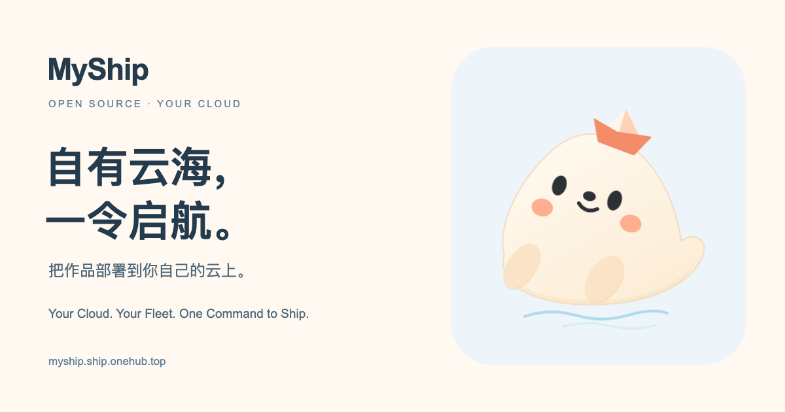

<div align="center">
  

  # ⚓ MyShip — 自有云海，一令启航。

  **Your Cloud. Your Fleet. One Command to Ship.**  
  **基于自有云设施（BYOC）的高 DX 内容寻址（CAS）全栈部署、泛域名路由与声明式云资源编排引擎。**

  [](https://www.npmjs.com/package/@myship/cli)
  [](./LICENSE)
  [](https://nodejs.org/)
  [](https://myship.ship.onehub.top)

  🌐 **[官方在线门户与文档站](https://myship.ship.onehub.top)** · 🚀 **[全栈在线样板间](https://fullstack-starter.ship.onehub.top)** · 🤖 **[AI Skill (`SKILL.md`)](https://myship.ship.onehub.top/skill/SKILL.md)** · 📄 **[AI 知识库 (`llms.txt`)](https://myship.ship.onehub.top/llms.txt)**
</div>

---

## 🎯 为什么要做 MyShip？(Why MyShip?)

国内主流静态与云托管平台通常将构建、路由与存储黑盒绑定，存在三个明显痛点：
1. **历史版本数量受限**（例如仅保留最近 10 次部署，早期构建链接自动失效）。
2. **子域名绑定死板**（通常只提供固定的生产/预览环境域名，无法随手为任意一次本地构建指定自定义预览子域名 `https://app1-v2.ship.example.com`）。
3. **前后端版本割裂与建库繁琐**（回滚时前端退回旧版但后端云函数仍是新版；每开一个新项目都要去云控制台手动建数据库、配账号、拼连接串）。

**MyShip** 采用 **BYOC（Bring Your Own Cloud，自带云设施）** 模式，只需利用你自己的 **1 个域名 + 腾讯云 EdgeOne 标准站点（免费版含泛域名与边缘函数）+ 腾讯云 COS 对象存储**（按需搭配 SCF Web 函数与 Serverless 数据库），即可获得：

| 特性维度 | 传统目录覆盖式托管 / 标准 Pages | ⚡ MyShip (EdgeOne + COS CAS + 全栈编排) |
| :--- | :--- | :--- |
| **历史版本保留** | 仅保留最近 N 个版本，旧版自动清理 | **无限静态版本保留**（每个版本仅占 ~1KB JSON 清单） |
| **上传速度与存储成本** | 每次全量复制目录，重复上传未改动的公共依赖 | **全局 SHA-256 内容寻址去重 (`blobs/<sha256>`)**，未改动文件 0 字节秒跳 |
| **自定义子域名自由度** | 仅限固定的生产/预览环境域名 | **任意单次构建可绑定任意数量子域名**（`*.ship.example.com` 自动享免费泛域名 HTTPS） |
| **多项目命名空间隔离** | 多个项目混杂或需频繁建新站点 | **内置 `.myship/project.json` 命名空间**（自动隔离域名、环境变量、存储前缀与数据库 Schema） |
| **线上切流与回滚耗时** | 需重新触发流水线或复制目录（数十秒至数分钟） | **0 毫秒原子切流/回滚**（仅改写 80 字节 `aliases/<subdomain>.json` 指针） |
| **双引擎全栈后端** | 前后端分离部署，回滚易出现接口版本错位 | **边缘 V8 (`api/*.js`) + SCF Node.js (`myship backend`)**，前后端共享同一 `dpl_<id>` 快照，0 秒同帧回滚 |
| **声明式云资源 (`myship use`)** | 手动登录控制台建库、建表空间、复制连接串 | **交互式一行命令开通并注入 `context.files` 与 `context.db`**（支持 CloudBase PG / Neon / Turso / D1 / MySQL） |

---

## 🚀 30 秒免云账号体验（Local Sandbox）

即使你还没有配置腾讯云账号或域名，克隆仓库后只需一行命令即可在本地完整体验 **V1/V2 增量构建、CAS 块级去重、泛域名并发路由与 0 秒原子回滚**：

```bash
git clone https://github.com/huxy2023/myship.git
cd myship

# 1. 运行本地离线 CAS 全链路自测与全套自动化测试
pnpm demo
pnpm test

# 2. 编译生成 MyShip 产品门户与技术文档站 (输出至 apps/site/dist)
pnpm build:site
```

---

## ☁️ 10 分钟接入你自己的云端底座 (BYOC Quickstart)

### 第 1 步：全局安装 `myship` CLI

```bash
npm i -g @myship/cli
myship --version
```

### 第 2 步：绑定你的腾讯云凭证与云底座配置

```bash
myship login
```
- **支持两种安全认证方式**：CAM 子账号最小权限密钥（纯静态发布仅需 `QcloudCOSDataFullControl`）或 `tccli auth login` 浏览器扫码授权。
- **全局边缘网关智能检测与一键回车上传**：`myship login` 自动探测云端泛域名网关是否在线；首次搭建只需敲一下回车，自动调用腾讯云 EdgeOne API 创建全局路由函数 `myship-cas-router` 并绑定规则（换新电脑登录自动跳过重复部署）。
- *(详细的 DNSPod 泛解析与免费泛域名 HTTPS 证书申请避坑指南，请阅读 👉 **[《从 0 到 1 自建云端底座保姆级指南》](./docs/02-self-hosting-guide.md)**)*。

### 第 3 步：在任意项目中享受 6 个字母的极简发布与全生命周期管控

```bash
cd /path/to/your-app

# 本地即时调试静态目录、api/*.js、SCF 全栈后端与本地 SQLite 数据库
myship dev

npm run build

# 直接输入 6 个字母！自动初始化 .myship/project.json 并发布至：
#   - 构建快照域名: https://app1-<hash>.ship.example.com
#   - 项目默认主域: https://app1.ship.example.com
myship

# 发布到当前项目的指定子环境（自动拼接项目前缀 -> https://app1-v2.ship.example.com）
myship -d v2

# 查看当前项目命名空间下的历史版本与线上域名（加 --all 查看全量项目分组）
myship ls

# 0 秒将当前项目主域名一键回退到上一个历史版本（前端页面与后端接口同帧原子回退！）
myship rollback

# 清理过期历史快照 (支持 --keep 或 --older-than 7d) 或精确删除指定快照/别名/项目
myship gc --dry-run
myship rm dpl_xxxx

# 一键生成 GitHub Actions 自动部署与 PR 预览工作流并同步仓库 Secrets
myship init --ci --sync-secrets

# 启动本机 127.0.0.1:4200 可视化 Web 管控台（一键切流/回滚/双版本 Diff/环境变量/GC）
myship console
```

### 第 4 步：双引擎全栈后端（边缘 V8 `api/*.js` 与 SCF Node.js `myship backend`）

- **轻量边缘函数 (`api/*.js`)**：在项目下新建 `api/hello.js`，执行 `myship` 时自动按 `SHA-256` 归档并同步至项目专属 EdgeOne V8 边缘函数（自动透传 `context.clientIp`、`context.geo` 与 `context.env`）。
- **完整 Node.js 全栈后端 (`myship backend enable`)**：当需要完整 Node.js 24/20 运行时、Hono 框架、第三方 npm 包或 SSE 流式输出时：

```bash
myship backend enable    # 开启 SCF Web 函数全栈模式并生成 server/index.mjs
myship dev               # 本地全栈热重载联调
myship                   # 构建 esbuild 内联 SourceMap 单包并冻结 SCF 不可变版本
myship logs --error      # 实时拉取云端日志并还原真实源码报错行号
```

### 第 5 步：声明式云资源编排 (`myship use`) — 多引擎数据库与对象文件存储

直接运行 `myship use` 启动交互式向导（或使用命令行参数），一行命令为当前项目自动建库/分配独立 Schema 并注入 `context.files` 与 `context.db`：

```bash
# 推荐：启动交互式 TUI 资源向导（支持 ↑/↓ 方向键选择，自动发现已有 CloudBase PG / Turso / Neon 底座）
myship use

# 或使用非交互式命令一键开通绑定：
myship use storage                         # 二进制文件存储 (COS files/<project>/ + 预签名直传 URL)
myship use db --provider pg                # 腾讯云 CloudBase PG / 原生 PG (自动创建 myship_<project> Schema)
myship use db --provider neon              # Neon Serverless PG (API Key 自动建库 + Schema 隔离)
myship use db --provider turso             # Turso Edge SQLite (自动识别组织、初始化 Group 并签发项目 Token)
myship use db --provider d1                # Cloudflare D1 Serverless SQLite (自动查找或创建 D1 数据库)
myship use db --provider mysql             # 原生 MySQL 8 / TDSQL-C (自动创建 myship_<project> 独立库)
```

在后端代码中通过统一的 `context.db`（提供 `query` / `execute` / `batch` 方法，SQL 方言遵循所选数据库引擎）与 `context.files` 调用：

```javascript
// 1. PostgreSQL 示例 (CloudBase PG / Neon / 原生 PG — 自动隔离至 myship_<project> Schema)
await context.db.execute('CREATE TABLE IF NOT EXISTS notes (id SERIAL PRIMARY KEY, title TEXT)');
await context.db.execute('INSERT INTO notes (title) VALUES ($1)', ['Hello MyShip']);
const { rows } = await context.db.query('SELECT * FROM notes');

// (若使用 Turso / D1 / 本地 node:sqlite，则使用 SQLite 方言：INTEGER PRIMARY KEY AUTOINCREMENT 与 ? 占位符)

// 2. 二进制文件存储与前端预签名直传 (COS files/<project>/ 隔离)
await context.files.put('uploads/readme.txt', 'Hello COS Files!', { contentType: 'text/plain' });
const uploadUrl = await context.files.presignUrl('uploads/avatar.png', { method: 'PUT', expiresIn: 900 });
```

---

## 📦 Monorepo 模块化工程结构 (`pnpm workspace`)

```text
myship/
├── LICENSE                              # MIT 开源许可证
├── README.md                            # 项目主页
├── CONTRIBUTING.md                      # 开源贡献与工程架构规范
├── pnpm-workspace.yaml                  # pnpm 工作区定义
├── package.json                         # 根配置 (含全局 bin.myship 入口)
│
├── packages/
│   ├── cli/                             # @myship/cli — 核心 CLI 与全栈运行时套件
│   │   ├── myship.mjs                   # CLI 命令路由与主控入口
│   │   ├── cos-client.mjs               # 腾讯云 COS XML v5 数据面签名客户端与全局凭证管理
│   │   ├── teo-client.mjs               # 腾讯云 EdgeOne (TEO) 管控面 API v3 与边缘函数路由编排
│   │   ├── tcb-client.mjs               # 腾讯云 CloudBase (TCB) 管控面 ExecutePGSql 与环境自动发现
│   │   ├── scf-bundler.mjs              # 全栈 esbuild 打包器、SCF 不可变版本发布与云端日志聚合器
│   │   ├── scf-bootstrap-runtime.mjs    # 云端 SCF 9000 端口 HTTP 容器引导层 (由 esbuild 真实编译打包)
│   │   ├── db-client.mjs                # 本地与云端 100% 共享的多引擎 SQL 客户端 (SQLite/Turso/D1/PG/Neon/MySQL)
│   │   ├── storage-client.mjs           # 本地与云端共享的 context.storage (KV)、context.files 与模块派发器
│   │   ├── resource-manager.mjs         # myship use 声明式云资源注册与凭证编排器
│   │   ├── resource-wizards.mjs         # myship use 交互式 TUI 向导与资源状态面板
│   │   ├── db-provisioners.mjs          # 五大数据库底层 Wire 协议与 HTTP API 自动建库/分 Schema 引擎
│   │   ├── tui-prompts.mjs              # 终端 Raw-Mode 方向键交互式选择器与输入组件
│   │   ├── template-generator.mjs       # myship init --template 零摩擦静态/边缘/全栈脚手架生成器
│   │   ├── console-server.mjs           # myship console 本地可视化管控台服务 (127.0.0.1:4200)
│   │   └── test/                        # 领域解耦的自动化测试套件 (core / resources / db-runtime)
│   │
│   └── edge-gateway/                    # @myship/edge-gateway — 边缘路由网关
│       ├── edgeone-function.template.js   # 纯净版全局静态 CAS 路由模板 (myship-cas-router)
│       ├── edgeone-api-worker.template.js # 项目级 API 边缘网关模板 (V8 预编译池 + SCF 全栈版本反向代理)
│       └── local-gateway.mjs            # 本地 4100 端口泛域名模拟网关 (*.ship.localhost:4100)
│
├── apps/
│   └── site/                            # @myship/site — 产品门户与技术文档站构建器
│       └── build-site.mjs               # 读取 docs/*.md 一键生成门户、交互式 Mermaid 画布与 /llms.txt
│
├── docs/                                # 统一文档中心 (Single Source of Truth)
│   ├── 01-quickstart.md                 # 📘 5 分钟快速上手与 CLI 命令全解
│   ├── 02-self-hosting-guide.md         # 🛠️ 从 0 到 1 自建云端底座保姆级指南
│   ├── 03-architecture.md               # 🏗️ CAS 三级指针架构与全栈运行时原理
│   └── 04-roadmap.md                    # 🧭 产品愿景与极致 DX 演进蓝图
│
└── examples/
    ├── cas-sandbox/                     # @myship/cas-sandbox — 离线沙盒自测与多版本演示脚本
    └── fullstack-starter/               # @myship/fullstack-starter — 全栈黄金样板工程 (SCF + DB + Storage + Files)
```

---

## 📚 核心文档导航

1. **[《5 分钟快速上手与 CLI 命令全解》](./docs/01-quickstart.md)**
2. **[《从 0 到 1 自建云端底座保姆级指南 (BYOC Setup & Troubleshooting)》](./docs/02-self-hosting-guide.md)**
3. **[《CAS 三级指针架构与全栈运行时原理》](./docs/03-architecture.md)**
4. **[《产品愿景与极致 DX 演进蓝图》](./docs/04-roadmap.md)**

---

## 品牌与吉祥物：小海豹 Skipper


**自有云海，一令启航。**<br>
*Your Cloud. Your Fleet. One Command to Ship.*

Skipper 是一只戴着小号珊瑚橘纸船帽的小海豹。纯净暖奶油色的身体、同色系软萌小前鳍与轻柔的海浪呼吸动效，陪你把做好的作品带到自己的云上。

- **[Logo](./apps/site/public/logo.svg)**：静谧海蓝底衬的小海豹图标，用于项目头像、网站导航栏与控制台。
- **[Favicon](./apps/site/public/favicon.svg)**：简化的高辨识度海豹头像，适配 16–32 px 浏览器标签页。
- **[吉祥物 Skipper](./apps/site/public/mascot-skipper.svg)**：透明底带轻柔呼吸浮动动效的完整矢量角色，自适应深浅双主题。
- **[品牌素材使用说明](./docs/05-brand-assets.md)**：矢量源、配色规范、分享图与导出方式。

<br clear="both" />

---

## 📄 开源许可 (License)

本项目基于 [MIT License](./LICENSE) 开源。
