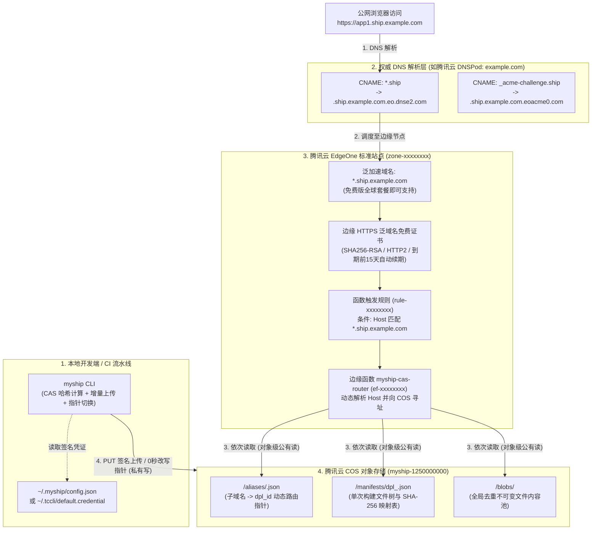

# 从 0 到 1 自建云端底座保姆级指南 (BYOC Setup & Troubleshooting)

**MyShip** 采用 **BYOC（Bring Your Own Cloud，自带云设施）** 架构。你不需要向任何第三方 SaaS 平台按月付费，只需利用你自己的 **1 个域名 + 腾讯云 COS 对象存储 + 腾讯云 EdgeOne 标准站点（免费版即可）**，就能在 10 分钟内搭建一套完全归你所有的个人级 `Vercel / surge.sh` 部署平台。

---

## 一、云端基础设施全景拓扑



---

## 二、四步搭建你自己的云端底座 (10 分钟 SOP)

假设你拥有的主域名为 `example.com`，我们规划将 **`*.ship.example.com`** 作为 MyShip 的专属泛域名空间（完全不影响你主域名 `@` 或 `www.example.com` 的现有业务）。

### 第 1 步：创建腾讯云 COS 存储桶（持久化 CAS 层）

1. 登录 [腾讯云 COS 控制台](https://console.cloud.tencent.com/cos5/bucket)，创建一个新存储桶：
   - **名称示例**：`myship-1250000000`（后缀为你的腾讯云 `AppId`）
   - **所属地域**：推荐就近选择（如 `ap-guangzhou` 或 `ap-shanghai`）
   - **访问权限**：保持默认的 **私有读写** 即可（`myship` 在每次上传文件块时会自动附加对象级 `x-cos-acl: public-read`，无需开启整桶公有写，安全防篡改）。
2. 复制该存储桶的访问域名，形如：
   `https://myship-1250000000.cos.ap-guangzhou.myqcloud.com`

---

### 第 2 步：在腾讯云 EdgeOne 标准站点接入泛域名与免费 HTTPS 证书

1. 登录 [腾讯云 EdgeOne 控制台](https://console.cloud.tencent.com/edgeone/zones)，添加站点 `example.com`：
   - **套餐选择**：选择 **免费版（Free Plan）** 即可（免费版即支持泛域名加速与每月百万次边缘函数调用）。
   - **接入方式**：推荐选择 **CNAME 接入（`partial`）**（既不影响主域名现有 DNS，也能避开部分新后缀域名的 Whois 校验问题，详见下文第 三 节避坑指南）。
2. 在【域名管理】中添加加速域名：
   - **加速域名**：输入 **`*.ship.example.com`**（开启泛域名）。
   - **源站配置**：选择你的 COS 存储桶域名 `myship-1250000000.cos.ap-guangzhou.myqcloud.com`。
3. 按 EdgeOne 界面提示，在你的 DNS 服务商（如 DNSPod）添加两条 CNAME 记录：

| 主机记录 (SubDomain) | 记录类型 | 记录值示例 | 配置作用说明 |
| :--- | :---: | :--- | :--- |
| **`*.ship`** | `CNAME` | `<assigned>.ship.example.com.eo.dnse2.com` | **【核心流量入口】** 将所有 `<任意名字>.ship.example.com` 指向 EdgeOne 全球边缘节点。 |
| **`_acme-challenge.ship`** | `CNAME` | `<zone-id>.ship.example.com.eoacme0.com` | **【HTTPS 自动签发与续期委派】** 在为 `*.ship.example.com` 申请免费边缘 HTTPS 证书时选择「DNS 委派验证」，配置后证书将在数分钟内自动签发并支持到期前 15 天自动续期。 |

---

### 第 3 步：在本机执行 `myship login`，敲回车一键上传全局边缘函数

在终端运行：

```bash
myship login
```

1. **选择认证方式（二选一）**：
   - **方式 `[1]` CAM 子账号密钥**：前往 [腾讯云 CAM 用户控制台](https://console.cloud.tencent.com/cam/user) 新建编程访问子账号。
     - **日常发包最小权限**：仅需授予 **`QcloudCOSDataFullControl`**（对象存储 COS 数据读写权限）。
     - **首次自动创建边缘函数权限（可选）**：若希望 CLI 自动帮你把边缘函数上传到 EdgeOne，可在首次配置时额外勾选 `QcloudTEOFullAccess`（或直接选用方式 `[2]` 扫码）。
   - **方式 `[2]` `tccli` 浏览器扫码授权**：自动唤起 `tccli auth login` 扫码登录，免建静态密钥。
2. **填入 COS 存储桶地址与泛域名后缀**（如 `ship.example.com`）。
3. **全局边缘函数智能探测与一键上传**：
   - **全账号共享 1 个云函数**：无论你有多少个前端项目、多少台电脑，云端永远只需要 **1 个全局边缘函数 (`myship-cas-router`)**。生成的全局函数代码统一保存在 **`~/.myship/edgeone-function.dist.js`**，绝不会在你的业务项目文件夹内产生任何冗余文件。
   - **换新电脑自动跳过**：`myship login` 会自动探测 `https://_myship_probe.ship.example.com`。如果你是在第二台新电脑上登录，探测到云端网关已在线后会自动跳过边缘函数部署！
   - **首次搭建敲回车直传**：首次搭建时，终端会提示：
     ```text
     👉 是否现在直接将该全局边缘函数自动上传并部署到腾讯云 EdgeOne？[Y/n (直接回车立即上传)]:
     ```
     **直接敲一下回车**，`myship` 会通过内置的 EdgeOne API 自动匹配你的站点、创建/更新 `myship-cas-router` 函数并配置触发规则！

*(注：若你日后更换了 COS 存储桶地址，随时运行 `myship setup-edge` 敲回车即可一键同步至云端；也可手动将 `~/.myship/edgeone-function.dist.js` 粘贴至 EdgeOne 控制台【边缘函数】中。)*

🎉 **大功告成！** 现在你可以在任意前端项目下直接输入 `myship`，1 秒发布你的第一个线上 HTTPS 站点了！

---

## 三、独家实战避坑指南 (FAQ & Troubleshooting)

以下是我们在真实生产环境（特别是 `.top` 等新顶级域名与 EdgeOne Pages 混用场景）中验证总结的高频避坑指南：

### 坑点 1：申请免费泛域名证书时报错 `ApplyCertDnsServerNotPointToDP` 怎么办？
- **现象**：你的域名明明已经在 DNSPod 解析，且在 EdgeOne 选择了「DNSPod 托管接入（`dnsPodAccess`）」，但在为 `*.ship.example.com` 申请免费泛域名 HTTPS 证书时却报错 `OperationDenied.ApplyCertDnsServerNotPointToDP`（提示 DNS 服务器未指向 DNSPod）。
- **根因**：对于 `.top` 等部分后缀，注册局 Whois 接口（`DescribeDomainWhois`）返回的 `NameServers` 可能为 `null`（导致 `ActualNsList: []`），从而触发 EdgeOne 在 `dnsPodAccess` 模式下的 NS 校验误判。
- **100% 解决法案**：
  将 EdgeOne 站点的接入模式从 `dnsPodAccess` 切换为 **CNAME 接入 (`partial`)**：
  ```bash
  tccli teo ModifyZone --ZoneId "zone-xxxxxxxx" --Type "partial"
  ```
  然后在证书申请界面选择 **「DNS 委派验证」**，在 DNSPod 添加一条 `_acme-challenge.ship` 的 CNAME 记录指向 `<zone-id>.ship.example.com.eoacme0.com`，约 3~5 分钟即可成功签发泛域名证书！

### 坑点 2：添加泛域名 `*.ship.example.com` 时报错 `DomainAlreadyExists`？
- **根因**：如果你此前在腾讯云 **EdgeOne Pages** 项目中添加过同名自定义域名，它会被绑定在隐藏的 `default-pages-zone` 下，导致标准站点无法重复添加同一域名。
- **解决法案**：先前往 EdgeOne Pages 控制台删除该自定义域名，等待约 1 分钟状态释放后，即可在标准站点顺利添加。

### 坑点 3：如何通过 HTTP 响应头快速排查当前子域名命中了哪个构建版本？
线上边缘函数会自动在每个响应中注入 4 个 `X-MyShip-*` 诊断头，随时可用 `curl -I` 巡检：

```bash
curl -I https://app1.ship.example.com/
```

响应头示例：
```http
HTTP/2 200
content-type: text/html; charset=UTF-8
x-myship-engine: EdgeOne-CAS-Gateway/1.0
x-myship-subdomain: app1
x-myship-deployment-id: dpl_6e46ed99
x-myship-blob-sha256: 5adc23fa1d2194f0...
```
