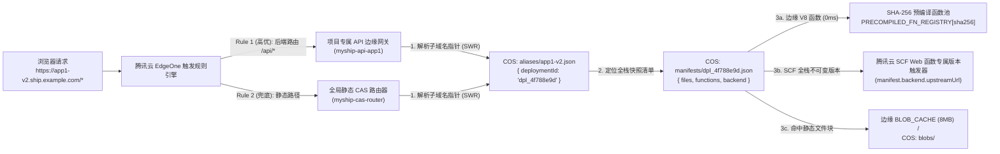

# CAS 三级指针架构与全栈运行时原理 (CAS & Full-Stack Architecture)

为什么传统的站点托管服务大多限制历史版本数量（例如只保留最近 10 次构建），而且切换版本或回滚需要几十秒甚至几分钟，甚至在回滚时出现“前端页面已回退、后端接口还是新版”的版本错位？
本章深入拆解 **MyShip** 如何借鉴 Git 与 Docker 镜像层的思想，用 **三级解耦指针架构** 实现**“无限静态版本保留 + 前后端同帧不可变绑定 + 0 毫秒原子切流”**。

---

## 一、传统“目录覆盖”模型 vs MyShip“三级指针”模型

### 1. 传统托管平台的瓶颈
传统平台在每次部署时，通常将构建产物整包上传并复制到 `/deployments/dpl_xxx/` 或直接覆盖 `/prod/` 目录：
- **存储膨胀快**：假设你的前端项目包含 5MB 的公共 JS/字体/图片，哪怕每次只改了 1 行文案，发布 100 次就会占用 500MB 存储。因此平台不得不强制清理早期版本。
- **切流与回滚慢且易错位**：回滚时需要重新复制文件或重新触发构建流水线，且后端云函数往往只存在单一 `$LATEST` 实例，导致前后端版本脱节。

### 2. MyShip 的三级解耦寻址流程（前后端同帧锁定）



---

## 二、COS 存储桶内的六大核心命名空间

在你的腾讯云 COS 存储桶中，公开静态寻址数据与项目私有业务数据通过对象级 ACL 与路径前缀严格隔离：

| 命名空间路径 | 访问权限 (`x-cos-acl`) | 生命周期 | 核心职责说明 |
| :--- | :---: | :---: | :--- |
| **`blobs/<sha256>`** | `public-read` | 永久不可变 | 全局内容寻址去重池，跨版本、跨项目共享相同文件块，未改动文件 `HEAD` 命中 0 字节秒跳 |
| **`manifests/dpl_<id>.json`** | `public-read` | 不可变快照 | 记录单次构建的前端文件树 (`files`)、边缘函数哈希 (`functions`) 与 SCF 全栈后端版本 (`backend`) |
| **`aliases/<subdomain>.json`** | `public-read` | 80B 动态指针 | 将任意子域名映射到指定的 `dpl_<id>`，改写即刻完成全球 0 秒切流或回滚 |
| **`envs/<project>.json`** | `private` | 项目级可变 | 私有存储当前项目的环境变量与 `myship use` 数据库连接凭证 |
| **`data/<project>/<key>.json`** | `private` | 独立持久化 | `context.storage` JSON 键值状态存储（代码回滚时绝不回滚或清空业务数据） |
| **`files/<project>/<key>`** | `private` | 独立持久化 | `context.files` 二进制对象存储池，支持服务端读写与前端预签名直传 (`presignUrl`) |

### 1. `manifests/dpl_<id>.json`（前后端一体的全栈快照清单）
每次执行 `myship` 发布时，生成的 `manifest` 同时锁定前端静态资源、边缘函数与 SCF 全栈后端的不可变版本号：

```json
{
  "id": "dpl_4f788e9d",
  "project": "app1",
  "immutableSubdomain": "app1-4f788e9d",
  "createdAt": "2026-11-03T08:00:00.000Z",
  "spaFallback": "/index.html",
  "files": {
    "/assets/vendor.js": {
      "sha256": "6f3ffee9d9...",
      "size": 142050,
      "contentType": "application/javascript; charset=UTF-8"
    },
    "/index.html": {
      "sha256": "5adc23fa1d...",
      "size": 2194,
      "contentType": "text/html; charset=UTF-8"
    }
  },
  "functions": {
    "/api/hello": {
      "sha256": "36908c5530bc8c08...",
      "entryFile": "api/hello.js",
      "runtime": "edge-js"
    }
  },
  "backend": {
    "mode": "scf-web",
    "functionName": "myship-app1",
    "version": "3",
    "upstreamUrl": "https://xxx.ap-guangzhou.tencentscf.com",
    "bundleSha256": "9a8b7c6d..."
  }
}
```

- **为什么前后端能做到 0 秒同帧回滚？**
  - 在边缘 V8 模式下，`manifest.functions` 锁定了函数代码的 `sha256`；
  - 在 SCF 全栈 Node.js 模式下，每次部署都会调用腾讯云 SCF `PublishVersion` 冻结一个不可变版本（如 `Version 3`）并绑定专属触发器 URL 写入 `manifest.backend.upstreamUrl`。
  - 当执行 `myship rollback` 改写 `aliases/app1.json` 指针时，前端 HTML 与后端接口在同一毫秒内切换回旧版 `manifest` 所指向的静态块与后端版本，彻底杜绝前后端版本错配。

---

## 三、本地与云端 100% 同构的全栈与数据库运行时

为了消除“本地 `myship dev` 能跑、上云 SCF 报错”的环境割裂，`MyShip` 在底层工程架构上实现了本地开发与云端 SCF 容器 **100% 共享同一套运行时核心模块**：

1. **统一多引擎数据库客户端 (`packages/cli/db-client.mjs`)**：
   - 本地开发 (`myship dev`) 与云端 SCF 引导层 (`scf-bootstrap-runtime.mjs`) 共同复用同一个 `createDatabaseClient` 实现（统一暴露 `query(sql, params)`、`execute(sql, params)`、`batch(statements)` 方法，SQL 方言遵循对应底层数据库引擎）：
     - **SQLite (`node:sqlite` / Turso / Cloudflare D1)**：当未绑定远端数据库或使用 SQLite 体系时，本地开发默认使用 Node.js 22+ 内置 `node:sqlite` 读写 `.myship/data/<project>/local.sqlite`（设置 `MYSHIP_DB_REMOTE=1` 可在本地直连远端）；云端通过 HTTP Pipeline 协议直连 Turso 或 Cloudflare D1。
     - **PostgreSQL (CloudBase PG / Neon / 原生 PG)**：本地与云端均直连目标 PG / Neon 实例，支持标准 `pg.Pool` 连接池复用（自动包裹事务级 `SET LOCAL search_path TO "myship_<project>", public` 兼容 PgBouncer `-pooler.` 连接池）、Neon HTTP SQL 零冷启动驱动以及 CloudBase `ExecutePGSql` 管控面兜底。
     - **MySQL (原生 MySQL 8 / TDSQL-C)**：本地与云端均基于 `mysql2/promise` 连接池直连并隔离至 `myship_<project>` 独立库。
2. **统一存储与请求派发器 (`packages/cli/storage-client.mjs`)**：
   - 统一封装 `context.storage`（JSON KV）与 `context.files`（二进制文件读写 + COS XML v5 预签名 URL 生成），以及兼容 Web Standard `fetch(request, context)`、Hono `app.fetch` 与 `GET/POST` 命名导出的模块派发器。
3. **SPA History 路由与三级边缘 V8 内存缓存**：
   - `MANIFEST_CACHE`：不可变清单首次读取后常驻边缘 V8 内存（0ms 命中）。
   - `BLOB_CACHE`：对 `<= 256 KB` 的高频静态文件采用 `Uint8Array` 零拷贝视图驻留内存，受 **`8 MB` 总字节账本**保护。
   - `ALIAS_CACHE`（SWR 异步刷新）：子域名指针在边缘内存极速响应，并利用 `event.waitUntil()` 后台异步刷新，兼顾 0ms 延迟与实时切流。
