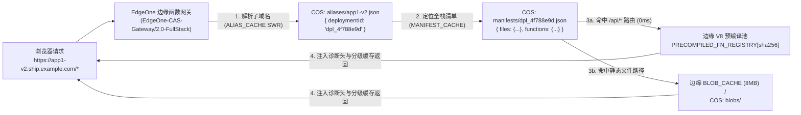

# CAS 三级指针架构原理与成本拆解 (CAS Architecture Deep Dive)

为什么传统的静态站点托管服务大多限制历史版本数量（例如只保留最近 10 次构建），而且切换版本或回滚需要几十秒甚至几分钟？  
本章深入拆解 **MyShip** 如何借鉴 Git 与 Docker 镜像层的思想，用 **三级解耦指针架构** 实现**“无限历史版本保留 + 0 毫秒原子切流”**。

---

## 一、传统“目录覆盖”模型 vs MyShip“三级指针”模型

### 1. 传统托管平台的瓶颈
传统平台在每次部署时，通常将构建产物整包上传并复制到 `/deployments/dpl_xxx/` 或直接覆盖 `/prod/` 目录：
- **存储膨胀快**：假设你的前端项目包含 5MB 的公共 JS/字体/图片，哪怕每次只改了 1 行文案，发布 100 次就会占用 500MB 存储。因此平台不得不强制清理早期版本。
- **切流与回滚慢**：回滚时需要重新复制文件或重新触发构建流水线，存在明显的生效延迟与中间态风险。

### 2. MyShip 的三级解耦寻址流程



---

## 二、COS 存储桶内的三大核心命名空间

在你的腾讯云 COS 存储桶中，所有数据被严格划分为三个正交目录：

### 1. `blobs/<sha256>`（全局内容寻址去重池 · 永久不可变）
- 存放所有文件去掉文件名后的原始字节流，直接以文件内容的 `SHA-256` 哈希值命名。
- 在执行 `myship` 部署时，CLI 对本地每个文件计算 `SHA-256`，并发起 `HEAD /blobs/<sha256>` 探测：
  - **若返回 `200 OK`**：说明该文件块已在云端存在，**0 字节直接跳过上传**！
  - **若返回 `404`**：仅上传真正发生变化的增量文件块。
- 无论你手头有 10 个项目还是发布了 1,000 个版本，相同的公共依赖库、图标、字体在 COS 里永远只有 1 份。

### 2. `manifests/dpl_<id>.json`（全栈构建快照清单 · 永久不可变）
- 记录某一次构建所属的项目命名空间（`project`）、前端静态文件树（`files`）与后端 Serverless 云函数路由表（`functions`），以及每个路径对应的 `sha256` 内容哈希：
  ```json
  {
    "id": "dpl_4f788e9d",
    "project": "app1",
    "immutableSubdomain": "app1-4f788e9d",
    "createdAt": "2026-10-29T05:36:31.465Z",
    "stats": {
      "totalFiles": 12,
      "uploadedBlobs": 1,
      "reusedBlobs": 11,
      "totalFunctions": 1,
      "uploadedFunctions": 1,
      "reusedFunctions": 0
    },
    "spaFallback": "/index.html",
    "files": {
      "/assets/vendor.js": {
        "sha256": "6f3ffee9d9...",
        "size": 142050,
        "contentType": "application/javascript; charset=UTF-8"
      },
      "/index.html": {
        "sha256": "5adc23fa1d...",
        "size": 2194,
        "contentType": "text/html; charset=UTF-8"
      }
    },
    "functions": {
      "/api/hello": {
        "sha256": "36908c5530bc8c08...",
        "entryFile": "api/hello.js",
        "runtime": "edge-js",
        "size": 412
      }
    }
  }
  ```
- **为什么能保留无限个历史版本？** 因为每个构建快照清单只是一个约 `1KB` 的 JSON 文件！保留 10,000 个历史构建清单仅占约 `10MB` 空间，成本几乎为零。
- **为什么前后端能做到 0 秒同帧回滚？** 因为 `functions` 的代码同样以 `sha256` 唯一索引预置在边缘 V8 引擎与 `blobs/<sha256>` 池中。子域名指针切换时，前端静态页面与后端 `/api/*` 云函数通过同一份 `manifest` 自动锁定对应版本的 `sha256`，绝不串版本！

### 3. `aliases/<subdomain>.json`（动态域名路由指针表 · 极小可变）
- 每个子域名对应一个仅约 `80 字节` 的轻量指针文件：
  ```json
  {
    "subdomain": "app1",
    "project": "app1",
    "deploymentId": "dpl_4f788e9d",
    "updatedAt": "2026-10-29T05:36:32.100Z"
  }
  ```
- **为什么切流和回滚是 0 秒？**
  当你执行 `myship rollback` 或 `myship alias v2 dpl_6e46ed99` 时，根本不需要搬运任何静态文件，只需用 50ms 改写这 80 字节的 JSON。由于边缘函数对 `aliases/` 采用 `no-cache` 实时读取，全球访问该子域名的下一秒请求即刻命中目标版本！

---

## 三、SPA History 路由与缓存控制策略

### 1. 原生支持 Vue / React History 路由模式
许多前端单页应用（SPA）开启了 `HTML5 History` 路由（如访问 `/users/profile`）。在 `MyShip` 中：
1. 若请求路径精确命中 `manifest.files[reqPath]`（如 `/assets/app.js`），直接返回对应文件块；
2. 若未命中且请求路径不含文件扩展名（如 `/users/profile`），边缘网关会自动回退读取构建产物中的 `/200.html` 或 `/index.html`，让前端路由无缝接管，绝不会出现刷新页面报 `404` 的问题。

### 2. 智能分级缓存头 (`Cache-Control`)、V8 内存加速与流式分片 (`Range 206`)
- **三级 V8 Isolate 内存缓存**：
  - `MANIFEST_CACHE`：由于 `manifests/dpl_<id>.json` 永久不可变，首次读取后常驻边缘节点 V8 内存（0ms 命中）。
  - `BLOB_CACHE`：对 `<= 256 KB` 的高频静态文件（如 `index.html`、图标、核心脚本）采用 `Uint8Array` 零拷贝视图驻留内存，并严格受 **`8 MB` 总字节账本**保护（远低于 EdgeOne `128 MB` 内存红线）。
  - `ALIAS_CACHE`（SWR 异步刷新）：子域名指针在内存中提供毫秒级响应，同时利用 `event.waitUntil()` 在后台异步刷新。
- **ETag 条件请求 (`304 Not Modified`)**：天然复用文件的 `SHA-256` 哈希作为强 `ETag`，浏览器二次刷新时在边缘直接返回 `304`，0 字节回源。
- **大文件与 `<video>` 流式分片 (`HTTP 206 Partial Content`)**：自动向 COS 透传 `Range` 请求头并返回 `206 Partial Content` 与 `Content-Range`，实现高清长视频进度条任意拖拽秒开。
