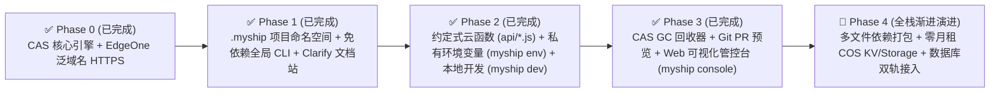

# 产品愿景与极致 DX 演进路线图 (Vision & DX Roadmap)

> 本文档定义了 **MyShip** 从“静态 CAS 部署引擎”演进为“个人级极致开发者体验 (DX) 全栈 Serverless 平台”的整体愿景、交互规范与分阶段工程路线图。

---

## 一、三大 DX（开发者体验）黄金准则

1. **Zero-Clone, Zero-SDK（免克隆源码、免重型云厂商 SDK 依赖）**
   - 在任何一台电脑、任意业务项目目录（Vue / React / Next / Astro / Vite）或 CI/CD 流水线中，开发者不需要安装数以百计的第三方 npm 依赖，也不需要强依赖 Python 和 `tccli`。
   - 仅依靠 Node.js 原生内置模块即可随时随地运行 `myship`。
2. **Zero-Config Default, Progressive Override（零参数直觉默认、渐进式覆盖）**
   - 日常高频发版只需敲 6 个字母：**`myship`**。
   - 工具自动探测项目的构建输出目录（`./dist`、`./build`、`./out`、`./public`），自动通过 `.myship/project.json` 关联项目命名空间，默认直发云端生产池。
3. **Immutable Everything, Instant Pointer Switch（万物不可变、指针秒级切换）**
   - 无论是当前的静态站点，还是未来接入的 Serverless 云函数，每一次构建都收敛为一份永久不可变的 `manifests/dpl_<id>.json`。
   - 域名永远只是一个 80 字节的轻量级指针（`aliases/<subdomain>.json`），切流与回滚永远在 0 秒内原子完成。

---

## 二、分阶段演进路线图 (Phased Roadmap)



---

## 三、Phase 2 架构实现（已上线）：职责解耦的独立 API 边缘函数 + SCF 重算力扩展槽

在项目中运行后端 API 接口或轻量服务时，无需改动现有的 DNS、泛域名 HTTPS 证书或 CAS 存储池，`MyShip` 采用**方案 A（独立 EdgeOne API 函数）+ 方案 C（腾讯云 SCF 函数 URL 反向代理扩展槽）**双轨设计：

1. **前后端边缘函数 100% 物理分离（方案 A · 默认主力）**：
   - **全局静态路由器 (`myship-cas-router`) 保持 100% 纯净**：绝不内联任何业务项目的 `api/*.js` 代码，仅负责全局静态 CAS 寻址、304 ETag、8MB 内存池与 206 视频流分片。
   - **独立统一 API 边缘函数（多项目 SHA-256 路由隔离）**：当项目包含 `api/*.js` 时，`myship` 自动同步至与静态网关完全分离的统一 API 边缘函数并维护高优触发规则，内部按 `host -> subdomain -> manifest -> functions[route].sha256` 寻址，确保多项目同名路由互不串线。
2. **函数源码私有归档与 CAS 内容寻址**：
   - `myship` 在扫描静态文件的同时，自动扫描 `api/**/*.{js,mjs}`，计算代码内容的 `SHA-256` 哈希并以私有权限 (`x-cos-acl: private`) 存入 `functions/<sha256>.json`。
   - 在 `manifests/dpl_<id>.json` 中记录前后端一体的版本快照：
     ```json
     {
       "id": "dpl_23a9ccd3",
       "project": "myship",
       "files": { "/index.html": { "sha256": "..." } },
       "functions": {
         "/api/hello": {
           "sha256": "7c577e8776903db1627c09d9e8e068156634b659bc95dd09159aebc5aafbd2af",
           "source": "api/hello.js",
           "runtime": "edge-js"
         },
         "/api/heavy-task": {
           "sha256": "...",
           "source": "api/heavy-task.js",
           "runtime": "scf-url",
           "upstreamUrl": "https://xxx.ap-guangzhou.tencentscf.com"
         }
       }
     }
     ```
3. **远期重算力扩展槽（方案 C · 腾讯云 SCF 函数 URL 反向代理）**：
   - 当某个接口需要运行完整 Node.js 容器（500MB 依赖包、900 秒长超时、原生数据库连接）时，只需在 `api/*.js` 中导出 `export const upstreamUrl = 'https://xxx.ap-guangzhou.tencentscf.com'`（或在 `api/upstreams.json` 中声明），边缘网关自动执行零跨域反向代理并透传 `X-MyShip-Deployment-Id` 等全套上下文头。
4. **前后端原子同步切流与回滚**：
   - 当执行 `myship rollback` 时，`https://app1.ship.example.com` 的前端静态页面与 `/api/*` 后端接口**在同一毫秒内同步回退到旧版本**，彻底消除前后端发版时间差导致的接口不兼容问题！

---

## 四、Phase 3 详细设计：生态闭环与可视化管控

1. **CAS 垃圾回收器与路由配额释放 (`myship gc` · ✅ 已完成)**：
   - 扫描所有保留的 `manifests/*.json` 与活跃 `aliases/*.json` 引用的 `sha256` 集合，自动清理无引用的孤儿 `blobs/` 与废弃 `functions/`，并同步释放 EdgeOne API 触发规则配额。
2. **项目级云函数环境变量与本地即时开发 (`myship env` & `myship dev` · ✅ 已完成)**：
   - 环境变量按项目命名空间私有存储在 `envs/<project>.json` (`x-cos-acl: private`)，支持 `context.env` 与 `process.env` 隔离注入及边缘热更新；`myship dev` 提供本地零配置全栈实时开发体验。
3. **GitHub Actions PR 预览机器人 (`myship init --ci` · ✅ 已完成)**：
   - 运行 `myship init --ci [--sync-secrets]` 一键生成 `.github/workflows/myship.yml` 并自动同步仓库 Secrets；Push `main` 自动发布生产主域，提交 PR 自动部署 `https://<project>-pr-<号>.<domain>` 并在 PR 评论区回复预览卡片。
4. **轻量单页 Web 可视化管控台 (`myship console` · ✅ 已完成)**：
   - 采用本机 `127.0.0.1:4200` 启动、复用本地 `~/.myship` 凭证直连腾讯云 COS / EdgeOne（或 `--local` 沙盒）的零公网密钥暴露架构，可视化查看所有项目的 `manifests/` 与 `aliases/`，支持鼠标点击 0 秒切流与回滚、任意两版本文件/云函数 SHA-256 Diff 对比、项目环境变量热更新与 GC 垃圾回收预检。

---

## 五、Phase 4 渐进式全栈后端能力演进（对标 Vercel 全栈体验，按需克制迭代）

遵循**“个人开发者 BYOC、零固定月租、不搞一步到位的大而全重构”**原则，后续后端与有状态能力按以下三个递进阶段按需迭代：

### 1. Stage 4.1（工程化提效）：云函数本地模块与轻量依赖打包 (Function Bundling)
- **痛点**：当前 `api/*.js` 为单文件零依赖转换，不支持 `import { auth } from './_utils.js'` 跨文件复用公共代码或引入纯 JS 轻量 npm 包（如 `zod`、`jose`）。
- **演进方案**：在 `myship` 部署与 `myship dev` 中支持将 `api/*.js` 引用的本地相对路径模块（约定以 `_` 开头的文件如 `api/_utils.js` 不单独暴露为路由）与纯 V8 兼容的轻量 npm 依赖打包为单文件后再注入边缘函数。

### 2. Stage 4.2（零额外云成本的有状态存储）：内置 `context.kv` 与 `context.storage`
- **痛点**：个人小项目常需存储少量 JSON 状态（留言、配置开关、短链映射）或用户上传的文件，单独购买云 Redis 实例固定月租过高，且边缘函数受 1MB 请求体限制无法直接中转大文件。
- **演进方案（100% 复用现有 COS 存储桶，零新增固定成本）**：
  - **轻量键值存储 (`context.kv`)**：基于 COS 私有路径 `kv/<project>/<key>.json`（`x-cos-acl: private`）封装 `await context.kv.get(key)` / `set(key, value)` / `delete(key)`，按项目命名空间严格隔离。
  - **对象存储与前端直传预签名 (`context.storage`)**：封装 `await context.storage.put(path, body)` 与 `context.storage.presignPutUrl(path, expiresSec)`，让前端可凭预签名 URL 直传大文件至 `storage/<project>/*`，绕开边缘函数 1MB 请求体限制。

### 3. Stage 4.3（重算力与关系型数据库）：数据库双轨接入 + 腾讯云 SCF 自动发布
- **路线 A（轻量首选 · 边缘 V8 + HTTP Serverless 数据库）**：
  - 针对纯 V8 沙盒不支持原生 TCP Socket 的特性，推荐配合支持 HTTP/WebSocket 协议的 Serverless 数据库（如 Neon Postgres、Supabase、Turso SQLite、Upstash），通过 `myship env set DATABASE_URL=...` 注入连接串，实现 0 冷启动、0 固定月租的数据读写。
- **路线 B（重算力突围 · 方案 C 腾讯云 SCF Node.js 自动打包发布）**：
  - 针对需要完整 Node.js 运行时、长耗时任务（AI 推理流、定时爬虫）或原生 TCP 连接传统 MySQL/PostgreSQL 的接口，基于已预留的 `upstreamUrl` 边缘反向代理扩展槽，在 CLI 中补齐将指定 `api/*.scf.js` 自动打包发布至腾讯云 SCF 并回填函数 URL 的闭环。
