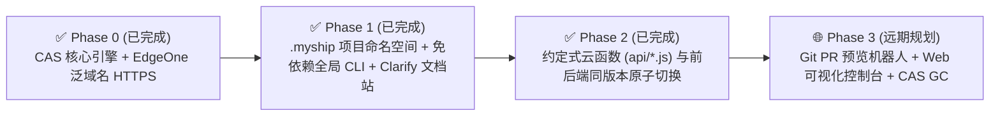

# 产品愿景与极致 DX 演进路线图 (Vision & DX Roadmap)

> 本文档定义了 **MyShip** 从“静态 CAS 部署引擎”演进为“个人级极致开发者体验 (DX) 全栈 Serverless 平台”的整体愿景、交互规范与分阶段工程路线图。

---

## 一、三大 DX（开发者体验）黄金准则

1. **Zero-Clone, Zero-SDK（免克隆源码、免重型云厂商 SDK 依赖）**
   - 在任何一台电脑、任意业务项目目录（Vue / React / Next / Astro / Vite）或 CI/CD 流水线中，开发者不需要安装数以百计的第三方 npm 依赖，也不需要强依赖 Python 和 `tccli`。
   - 仅依靠 Node.js 原生内置模块即可随时随地运行 `myship`。
2. **Zero-Config Default, Progressive Override（零参数直觉默认、渐进式覆盖）**
   - 日常高频发版只需敲 6 个字母：**`myship`**。
   - 工具自动探测项目的构建输出目录（`./dist`、`./build`、`./out`、`./public`），自动通过 `.myship/project.json` 关联项目命名空间，默认直发云端生产池。
3. **Immutable Everything, Instant Pointer Switch（万物不可变、指针秒级切换）**
   - 无论是当前的静态站点，还是未来接入的 Serverless 云函数，每一次构建都收敛为一份永久不可变的 `manifests/dpl_<id>.json`。
   - 域名永远只是一个 80 字节的轻量级指针（`aliases/<subdomain>.json`），切流与回滚永远在 0 秒内原子完成。

---

## 二、分阶段演进路线图 (Phased Roadmap)



---

## 三、Phase 2 架构实现（已上线）：约定式 Serverless 云函数与全栈版本隔离

在项目中运行后端 API 接口或轻量服务时，无需改动现有的 DNS、泛域名 HTTPS 证书或 CAS 存储池，`MyShip` 通过扩展不可变的 `manifest` 契约与边缘 V8 预编译池，实现了零配置全栈部署：

1. **约定式后端目录 (`api/*.js`)**：
   - 在业务项目中编写 `api/hello.js`（支持标准 Web `export default async function(request, context)` 或按 HTTP 方法导出 `GET` / `POST` / `PUT` / `DELETE`）。
2. **函数代码同样进入 CAS 内容寻址池与边缘 V8 预编译注册表**：
   - `myship` 在扫描静态文件的同时，自动扫描 `api/**/*.{js,mjs}`，计算代码内容的 `SHA-256` 哈希并存入 `blobs/<sha256>` 与 `functions/<sha256>.json`。
   - 同时将不同历史版本的函数代码以 `sha256` 为唯一键编译进边缘网关的 `PRECOMPILED_FN_REGISTRY`（零 `eval` CSP 风险，0ms 原生 V8 直接调用）。
   - 在 `manifests/dpl_<id>.json` 中记录前后端一体的版本快照：
     ```json
     {
       "id": "dpl_08a69bc4",
       "project": "app1",
       "files": { "/index.html": { "sha256": "..." } },
       "functions": {
         "/api/hello": {
           "sha256": "36908c5530bc8c08d80172b5f351835b79aa273b2beaf5531a136264dc73602b",
           "entryFile": "api/hello.js",
           "runtime": "edge-js"
         }
       }
     }
     ```
3. **前后端原子同步切流与回滚**：
   - 当执行 `myship rollback` 时，`https://app1.ship.example.com` 的前端静态页面与 `/api/*` 后端接口**在同一毫秒内同步回退到旧版本**，彻底消除前后端发版时间差导致的接口不兼容问题！

---

## 四、Phase 3 详细设计：生态闭环与可视化管控

1. **GitHub Actions PR 预览机器人**：
   - 在任意业务仓库配置 10 行 GitHub Actions Workflow，每次提交 PR 自动执行 `npx @myship/cli ./dist pr-${{ github.event.number }}`，并在 PR 评论区自动回复独立预览链接。
2. **Web 可视化管理后台 (`https://console.ship.example.com`)**：
   - 直接托管在 `console.ship.example.com` 上的单页控制台，可视化查看所有项目的 `manifests/` 与 `aliases/`，支持网页端鼠标点击一键切流、对比两个版本的文件差异。
3. **CAS 垃圾回收器 (`myship gc`)**：
   - 扫描所有保留的 `manifests/*.json` 引用的 `sha256` 集合，自动清理无任何构建版本引用的孤儿 `blobs/`，确保长期存储成本趋近于零。
