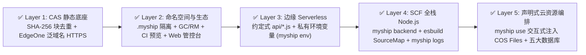

# 产品愿景与极致 DX 演进蓝图 (Vision & DX Architecture)

> 本文档定义了 **MyShip** 从“静态 CAS 部署引擎”构建为“个人级极致开发者体验 (DX) 全栈 Serverless 与云资源编排平台”的核心设计哲学与完整能力版图。

---

## 一、三大 DX（开发者体验）黄金准则

1. **BYOC & Zero Lock-in（100% 自有云底座、零平台月租锁定）**
   - 你的域名、证书、静态存储桶、云函数与数据库 100% 运行在你自己的云账号下，按量计费、零固定月租，随时可独立迁移。
   - 任何新电脑只需 `npm i -g @myship/cli` 即可一键复用云端配置与多数据库底座。
2. **Zero-Config Default, Progressive Power（零参数直觉默认、渐进式全栈增强）**
   - **纯静态发布**：日常只需敲 6 个字母 **`myship`**，自动识别构建目录并绑定项目命名空间。
   - **轻量边缘接口**：放入 `api/*.js` 即刻获得全球边缘 V8 Serverless 接口。
   - **重型全栈后端**：一行 `myship backend enable` 即刻升级为完整 Node.js 24/20 SCF Web 函数（支持 Hono、SSE 流式输出与内联 SourceMap）。
   - **声明式云资源**：一行 `myship use` 即刻通过交互式菜单开通并注入对象文件存储 (`context.files`) 与五大 Serverless 数据库 (`context.db`)。
3. **Immutable Code, Persistent Data, Instant Rollback（代码不可变、数据持久化、指针秒级切换）**
   - 每一次构建的前端静态文件、边缘函数哈希与 SCF 后端版本号都冻结为不可变的 `manifests/dpl_<id>.json`。
   - 线上域名永远只是一个 80 字节的轻量指针（`aliases/<subdomain>.json`），执行 `myship rollback` 时前后端代码在 0 秒内同帧原子回退，而 `context.storage`、`context.files` 与 `context.db` 中的业务持久化数据 100% 完好保留。

---

## 二、核心能力演进全景图

---

## 三、五大核心工程支柱详解

### 1. 全局 CAS 内容寻址与多项目命名空间隔离
- **跨项目块级去重 (`blobs/<sha256>`)**：无论发布多少个版本或项目，相同的公共依赖与媒体资产在 COS 中仅存一份。
- **项目级视图与引用计数安全回收 (`myship gc` / `myship rm`)**：精确扫描所有保留 `manifest` 与活跃 `alias` 的 `sha256` 引用计数，清理过期预览版本或销毁单个项目时绝不误删跨项目共享块。

### 2. 约定式边缘 Serverless 云函数 (`api/*.js`)
- **静态网关与 API 网关物理隔离**：全局静态路由器（`myship-cas-router`）保持 100% 纯净；当项目包含后端接口时，自动维护项目专属 API 边缘网关，按 `host -> subdomain -> manifest` 精确寻址。
- **双向签名兼容与防崩护栏**：同时支持 Web 标准 `GET(request, context)` 与 EdgeOne 官方 `onRequestGet(context)`，内置 `Response.json` / `process.env` 垫片與 8MB 边缘内存水位保护。

### 3. 全栈 Node.js 后端与不可变版本路由 (`myship backend`)
- **工业级 `esbuild` 单包编译 + 内联 SourceMap**：自动将 `server/index.mjs`（或 Hono 应用）连同真实编译期依赖打包为 ESM 单文件，并开启 `sourcemap: 'inline'` 与 `node --enable-source-maps`，云端报错通过 `myship logs` 直接还原至源码真实行号。
- **SCF 不可变版本冻结与 8 版本滑动窗口**：每次部署自动发布独立 SCF 版本与专属触发器写入 `manifest.backend`，保留当前活跃别名锁定版本 + 最近预览版本（上限 8 个版本），彻底解决传统云函数 `$LATEST` 覆盖导致的线上预览串线问题。

### 4. 声明式云资源注册与自动注入引擎 (`myship use`)
提供**“一次配置全局底座，任何新项目一行 `myship use` 即刻注入存储与数据库”**的极简体验：

| 资源类型 | 命令 / 交互入口 | 物理开通与多项目隔离机制 | 运行时调用方式 |
| :--- | :--- | :--- | :--- |
| **二进制文件存储 (`files`)** | `myship use` -> `storage` | 复用全局 COS 桶，按 `files/<project>/<key>` 前缀私有隔离 | `context.files.put / get / delete / list / presignUrl` |
| **腾讯云 CloudBase PG (`pg`)** | `myship use` -> `pg` | 自动扫描账号下 CloudBase PG 实例、开启公网并创建 `myship_<project>` 独立 Schema | `context.db.query / execute / batch` 或 `DATABASE_URL` |
| **Neon Serverless PG (`neon`)** | `myship use` -> `neon` | 自动识别 Neon 组织与项目、创建逻辑库并为每个应用隔离 `myship_<project>` Schema | `context.db.query / execute / batch` 或 `DATABASE_URL` |
| **Turso Edge SQLite (`turso`)** | `myship use` -> `turso` | 自动识别 Turso 组织、初始化默认 Group，创建 `myship-<project>` 库并签发项目 Token | `context.db.query / execute / batch` 或 `TURSO_DATABASE_URL` |
| **Cloudflare D1 (`d1`)** | `myship use` -> `d1` | 自动调用 Cloudflare API 查找或创建 `myship-<project>` D1 数据库 | `context.db.query / execute / batch` |
| **MySQL 8 / TDSQL-C (`mysql`)** | `myship use` -> `mysql` | 通过原生 Wire 协议或 `mysql2` 自动执行 `CREATE DATABASE myship_<project>` | `context.db.query / execute / batch` 或 `MYSQL_URL` |

### 5. 全局底座复用与项目级命名空间隔离
- 只需在 `~/.myship/config.json` 配置一次全局底座凭证，所有新项目执行 `myship use` 时零摩擦共享底层云实例，并自动按 **COS 路径前缀 (`files/<project>/`)**、**PostgreSQL Schema (`myship_<project>`)** 或 **独立数据库 (`myship_<project>`)** 实现多项目物理隔离。
- `.myship/project.json` 中的 `resources` 字段预留了 `isolation` 标记位（当前版本统一采用全局凭证复用 + 路径前缀/Schema/库名隔离；项目级独立最小权限子凭证自动签发作为远期演进预留能力）。

---

## 四、下一阶段演进待选池 (Next Horizon Backlog)

在五大核心架构层级（Layer 1–5）全部跑通闭环的基础上，后续迭代遵循**“克制交付、反过度设计、按需择机推进”**原则，重点围绕以下六个高价值方向展开：

### 1. 📦 全栈标准样板工程与 NPM 版本持续交付 (`Full-Stack Starter & Release` · ✅ 已实现)
- **NPM 正式包迭代发布**：将本地与云端 100% 同源的模块化运行时（`db-client.mjs`、`storage-client.mjs`、`scf-bootstrap-runtime.mjs`）及新账号零配置初始化能力持续同步至 `@myship/cli` 官方源。
- **全栈黄金样板工程 (`examples/fullstack-starter`)**：提供一套最小闭环的全栈参考范本，完整串联「前端静态构建 + `server/index.mjs` (SCF Web 函数) + `context.db` 数据库读写 + `context.files.presignUrl` 对象存储直传」，既作为端到端冒烟验证基准，也作为开发者新建全栈项目的开箱模板。

### 2. 🖥️ `myship console` 可视化管控台全栈化升级 (`Console v2` · ✅ 已实现)
- **云资源状态全景面板**：在本地 `127.0.0.1:4200` 管控台中直观展示各项目通过 `myship use` 绑定的数据库引擎（PG / Neon / Turso / D1 / MySQL）、隔离 Schema / 库名及 COS 存储前缀（`data/<project>/`、`files/<project>/`），并提供在线只读表数据与对象浏览器。
- **SCF 全栈版本与日志聚合视图**：在管控台的部署快照详情中展示绑定的 SCF 不可变版本号（`manifest.backend`），并集成 `myship logs` 云端运行日志与 SourceMap 源码级报错堆栈一键查看能力。

### 3. 🧹 第二阶段模块化内聚治理 (`Modular Architecture Phase 2` · ✅ 已实现)
- **交互式向导独立拆分 (`resource-wizards.mjs`)**：将 `packages/cli/resource-manager.mjs` 中的终端交互式引导流程（`promptUseTargetWizard` / `promptDbProviderWizard` / 各数据库交互式参数采集与状态面板）独立拆出，使 `resource-manager.mjs` 专注于声明式资源编排。
- **云厂商管控面客户端正交化 (`teo-client.mjs` / `tcb-client.mjs`)**：将 `packages/cli/cos-client.mjs` 中混放的腾讯云 EdgeOne (`TEO`) 与 CloudBase (`TCB`) 管控面 API 剥离为独立模块，使 `cos-client.mjs` 100% 专注于对象存储数据面与 XML v5 签名。

### 4. 🤖 AI Vibecoding 专属技能包封装 (`myship-skill` · ✅ 已实现)
- **高密度渐进式 Agent Skill (`skills/myship-skill/SKILL.md` + `references/`)**：面向 Google Antigravity、Claude Code、Cursor 等 AI 编程代理，封装标准化的 MyShip 全栈开发技能指令（涵盖架构选型决策树、`myship use` 资源编排、`context.db` 各数据库 SQL 方言规范、`context.files.presignUrl` 预签名直传范式、`server/index.mjs` 打包契约与 6 大避坑铁律）。
- **CLI 一键分发与在线直链 (`myship skill`)**：支持执行 `myship skill install -g` 一键安装至本机全局 AI 代理目录（`~/.gemini/config/skills/`、`~/.agents/skills/`、`~/.claude/skills/`）或当前工程 `.agents/skills/myship-skill/`，同时在官网提供 `/skill/SKILL.md` 在线直链。

### 5. 🩺 云底座与项目健康巡检诊断 (`myship doctor` · 待选)
- **全局底座与凭证有效性自检**：一键检测本机 `~/.myship/config.json` 或 `~/.tccli/default.credential` 凭证状态（若为 STS 临时凭证则提示剩余有效期）、COS 存储桶连通性与读写权限，以及 EdgeOne 泛域名网关 `myship-cas-router` 的在线响应状态。
- **项目级数据库与云函数连通性探针**：针对当前项目已通过 `myship use` 绑定的数据库（CloudBase PG / Neon / Turso / D1 / MySQL）自动执行 `SELECT 1` 与隔离 Schema 存在性核验，输出清晰的逐项勾检报告与修复命令建议。

### 6. 🚀 零摩擦全栈工程脚手架生成 (`myship init --template` · ✅ 已实现)
- **开箱即用的轻量标准模板 (`packages/cli/template-generator.mjs`)**：支持在空目录执行 `myship init --template static | edge | fullstack`（或交互式 `myship create [目录]`），一键生成最小可运行的静态页、边缘函数 (`api/hello.js`) 或 SCF 全栈后端 (`server/index.mjs` + `.myship/project.json`) 骨架，默认非破坏性保留已有文件，实现从空目录到 `myship dev` / `myship` 上线的 10 秒闭环。

### 7. ⏸️ 三粒度可逆上下线与漏洞版本秒级封禁 (`myship offline / online` · ✅ 已实现)
- **正交双层状态机 (`disabled` + `projectDisabled`)**：支持按「整项目」、「单子域名 (`--alias`)」或「单构建版本 (`dpl_xxx`)」三个粒度一键暂停访问与无损恢复，切流与新发版本自动继承项目离线状态，`myship rollback` 自动跳过已禁用版本。
- **全链路边缘 503 拦截与可视化管控**：在全局静态网关、项目 API 网关、本地网关及 `myship console` 可视化管控台实现统一的 503 维护页/JSON 短路响应与一键开关。
