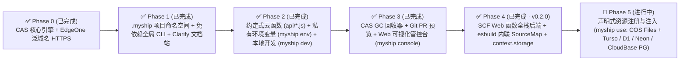

# 产品愿景与极致 DX 演进路线图 (Vision & DX Roadmap)

> 本文档定义了 **MyShip** 从“静态 CAS 部署引擎”演进为“个人级极致开发者体验 (DX) 全栈 Serverless 平台”的整体愿景、交互规范与分阶段工程路线图。

---

## 一、三大 DX（开发者体验）黄金准则

1. **Zero-Clone, Zero-SDK（免克隆源码、免重型云厂商 SDK 依赖）**
   - 在任何一台电脑、任意业务项目目录（Vue / React / Next / Astro / Vite）或 CI/CD 流水线中，开发者不需要安装数以百计的第三方 npm 依赖，也不需要强依赖 Python 和 `tccli`。
   - 仅依靠 Node.js 原生内置模块即可随时随地运行 `myship`。
2. **Zero-Config Default, Progressive Override（零参数直觉默认、渐进式覆盖）**
   - 日常高频发版只需敲 6 个字母：**`myship`**。
   - 工具自动探测项目的构建输出目录（`./dist`、`./build`、`./out`、`./public`），自动通过 `.myship/project.json` 关联项目命名空间，默认直发云端生产池。
3. **Immutable Everything, Instant Pointer Switch（万物不可变、指针秒级切换）**
   - 无论是当前的静态站点，还是未来接入的 Serverless 云函数，每一次构建都收敛为一份永久不可变的 `manifests/dpl_<id>.json`。
   - 域名永远只是一个 80 字节的轻量级指针（`aliases/<subdomain>.json`），切流与回滚永远在 0 秒内原子完成。

---

## 二、分阶段演进路线图 (Phased Roadmap)



---

## 三、Phase 2 架构实现（已上线）：职责解耦的独立 API 边缘函数 + SCF 重算力扩展槽

在项目中运行后端 API 接口或轻量服务时，无需改动现有的 DNS、泛域名 HTTPS 证书或 CAS 存储池，`MyShip` 采用**方案 A（独立 EdgeOne API 函数）+ 方案 C（腾讯云 SCF 函数 URL 反向代理扩展槽）**双轨设计：

1. **前后端边缘函数 100% 物理分离（方案 A · 默认主力）**：
   - **全局静态路由器 (`myship-cas-router`) 保持 100% 纯净**：绝不内联任何业务项目的 `api/*.js` 代码，仅负责全局静态 CAS 寻址、304 ETag、8MB 内存池与 206 视频流分片。
   - **独立统一 API 边缘函数（多项目 SHA-256 路由隔离）**：当项目包含 `api/*.js` 时，`myship` 自动同步至与静态网关完全分离的统一 API 边缘函数并维护高优触发规则，内部按 `host -> subdomain -> manifest -> functions[route].sha256` 寻址，确保多项目同名路由互不串线。
2. **函数源码私有归档与 CAS 内容寻址**：
   - `myship` 在扫描静态文件的同时，自动扫描 `api/**/*.{js,mjs}`，计算代码内容的 `SHA-256` 哈希并以私有权限 (`x-cos-acl: private`) 存入 `functions/<sha256>.json`。
   - 在 `manifests/dpl_<id>.json` 中记录前后端一体的版本快照：
     ```json
     {
       "id": "dpl_23a9ccd3",
       "project": "myship",
       "files": { "/index.html": { "sha256": "..." } },
       "functions": {
         "/api/hello": {
           "sha256": "7c577e8776903db1627c09d9e8e068156634b659bc95dd09159aebc5aafbd2af",
           "source": "api/hello.js",
           "runtime": "edge-js"
         },
         "/api/heavy-task": {
           "sha256": "...",
           "source": "api/heavy-task.js",
           "runtime": "scf-url",
           "upstreamUrl": "https://xxx.ap-guangzhou.tencentscf.com"
         }
       }
     }
     ```
3. **远期重算力扩展槽（方案 C · 腾讯云 SCF 函数 URL 反向代理）**：
   - 当某个接口需要运行完整 Node.js 容器（500MB 依赖包、900 秒长超时、原生数据库连接）时，只需在 `api/*.js` 中导出 `export const upstreamUrl = 'https://xxx.ap-guangzhou.tencentscf.com'`（或在 `api/upstreams.json` 中声明），边缘网关自动执行零跨域反向代理并透传 `X-MyShip-Deployment-Id` 等全套上下文头。
4. **前后端原子同步切流与回滚**：
   - 当执行 `myship rollback` 时，`https://app1.ship.example.com` 的前端静态页面与 `/api/*` 后端接口**在同一毫秒内同步回退到旧版本**，彻底消除前后端发版时间差导致的接口不兼容问题！

---

## 四、Phase 3 详细设计：生态闭环与可视化管控

1. **CAS 垃圾回收器与路由配额释放 (`myship gc` · ✅ 已完成)**：
   - 扫描所有保留的 `manifests/*.json` 与活跃 `aliases/*.json` 引用的 `sha256` 集合，自动清理无引用的孤儿 `blobs/` 与废弃 `functions/`，并同步释放 EdgeOne API 触发规则配额。
2. **项目级云函数环境变量与本地即时开发 (`myship env` & `myship dev` · ✅ 已完成)**：
   - 环境变量按项目命名空间私有存储在 `envs/<project>.json` (`x-cos-acl: private`)，支持 `context.env` 与 `process.env` 隔离注入及边缘热更新；`myship dev` 提供本地零配置全栈实时开发体验。
3. **GitHub Actions PR 预览机器人 (`myship init --ci` · ✅ 已完成)**：
   - 运行 `myship init --ci [--sync-secrets]` 一键生成 `.github/workflows/myship.yml` 并自动同步仓库 Secrets；Push `main` 自动发布生产主域，提交 PR 自动部署 `https://<project>-pr-<号>.<domain>` 并在 PR 评论区回复预览卡片。
4. **轻量单页 Web 可视化管控台 (`myship console` · ✅ 已完成)**：
   - 采用本机 `127.0.0.1:4200` 启动、复用本地 `~/.myship` 凭证直连腾讯云 COS / EdgeOne（或 `--local` 沙盒）的零公网密钥暴露架构，可视化查看所有项目的 `manifests/` 与 `aliases/`，支持鼠标点击 0 秒切流与回滚、任意两版本文件/云函数 SHA-256 Diff 对比、项目环境变量热更新与 GC 垃圾回收预检。

---

## 五、Phase 4 全栈 Node.js 后端与不可变版本路由（✅ 已完成 · `v0.2.0`）

遵循**“强契约、克制设计、零固定月租”**原则，Phase 4 落地了基于腾讯云 SCF Web 函数的完整 Node.js 全栈能力：

1. **显式开启的全栈后端开关 (`myship backend enable`)**：
   - 未开启时保持 100% 纯静态 CAS 零损耗心智；开启后支持单入口 Web Fetch / Hono（如 `server/index.mjs`）或多路由 `api/*.mjs`。
2. **工业级 `esbuild` 单包打包 + 原生内联 SourceMap**：
   - 采用 `esbuild`（`bundle: true, format: 'esm', platform: 'node', sourcemap: 'inline'`）结合 `node --enable-source-maps` 与 `process.setSourceMapsEnabled(true)`，自动递归保留 `server/` 下静态资产文件，报错堆栈精准定位至源码真实文件与行号。
3. **内置私有状态存储 (`context.storage`) 与日志诊断 (`myship logs`)**：
   - 基于 COS 私有前缀 `data/<project>/<key>.json`（`x-cos-acl: private`）封装 `context.storage.get/set/delete/list`，本地 `myship dev` 自动映射至 `.myship/data/<project>/`；`myship logs` 聚合云端 SCF 日志与私有异常归档。
4. **不可变版本发布与 8 版本统一保留策略**：
   - 每次部署自动发布不可变 SCF 版本与专属 HTTP 触发器，在 `manifests/dpl_<id>.json` 中绑定 `backend.upstreamUrl`，并统一维护项目级 8 版本上限（活跃别名锁定版本 + 最新预览版本），支持前后端原子秒级回滚。

---

## 六、Phase 5 声明式资源注册与自动注入引擎 (`myship use` · 进行中)

面向个人与全栈开发高频刚需，提供**“一次配置全局底座，任何新项目一行 `myship use` 即刻注入对象存储与数据库”**的极简资源编排体验，并遵循**“前期宽松共享、后期无缝收紧 (`isolation: 'shared' | 'strict'`)”**的演进架构：

### 1. 对象存储声明与注入 (`myship use storage` / `myship use files`)
- **隔离模型**：复用全局 COS 存储桶，通过**项目路径前缀（Object Path Prefix）**天然隔离：
  - JSON 键值状态：`data/<project>/<key>.json`（通过 `context.storage` 访问）
  - 二进制文件存储：`files/<project>/<key>`（通过新增的 **`context.files`** / `context.bucket` 访问，支持 `put`、`get`、`delete`、`list` 及免经过云函数的 **COS 预签名直传/下载 `presignUrl`**）
- **环境策略**：默认采用 **2 环境模型**（本地 `myship dev` 读写 `.myship/files/<project>/`，云端读写 COS `files/<project>/`），同时预留 `MYSHIP_STORAGE_ENV` 环境变量支持按需切分子环境前缀（`files/<project>/<env>/`）。

### 2. 五大数据库声明与自动注入 (`myship use db [--provider <turso|d1|neon|pg|mysql>]`)
采用行业标准的 **2 环境默认模型（Local 本地开发 + Prod 云端生产，可选 `--env staging` 测试环境）**，支持**全局默认数据库平台 (`defaultDbProvider`) + 多平台凭证并存 + 项目级按需覆盖**，原生兼容五大数据库：

| 数据库类型 | 适用场景 | 隔离与自动开通机制 | 运行时使用方式 |
| :--- | :--- | :--- | :--- |
| **Turso (Edge SQLite)** | 个人全栈 / 边缘低延迟 SQLite / 零固定月租 | 全局配置一次 `tursoApiToken` + `tursoOrg`，执行 `myship use db --provider turso` 自动调用 Turso API 创建 `myship-<project>` 独立库并签发项目专属 Token | 直接调用内置零依赖 `await context.db.query(sql, params)` / `execute(sql, params)` / `batch(stmts)`（或读取 `TURSO_DATABASE_URL`） |
| **Cloudflare D1 (Serverless SQLite)** | 已有 Cloudflare 账号 / 标准 SQLite 生态 | 全局配置一次 `cfAccountId` + `cfApiToken`，执行 `myship use db --provider d1` 自动调用 Cloudflare API 查找或创建 `myship-<project>` D1 数据库 | 直接调用内置零依赖 `await context.db.query(sql, params)` / `execute(sql, params)` / `batch(stmts)`（底层直连 D1 HTTP API） |
| **Neon (Serverless PostgreSQL)** | 零月租 Serverless PG / 原生 HTTP SQL + 分支生态 | 支持：① 配置全局 `neonApiKey` 自动通过 Neon API v2 创建项目专属逻辑库 `myship_<project>`；或 ② 配置全局 `neonMasterUrl` 自动按项目派生独立 Schema (`myship_<project>`) | **双模支持**：既可直接调用内置零依赖 `await context.db.query(sql, params)`（底层直连 Neon Serverless HTTP `/sql` 接口），也可通过 `DATABASE_URL` 对接 Drizzle / Prisma / `@neondatabase/serverless` |
| **腾讯云 CloudBase PG / 原生 PostgreSQL (`pg`)** | 同云低延迟 / 专业自建 PG / Prisma & Drizzle 生态 | 全局配置一次 `pgMasterUrl`，执行 `myship use db --provider pg` 自动为项目派生独立 Schema（或 `--isolate db` 独立库名，或 `--raw` 直连自定义库） | 自动注入标准 `process.env.DATABASE_URL` 与 `PG_SCHEMA`，无缝对接 `pg`、`postgres`、Drizzle、Prisma |
| **原生 MySQL / MariaDB / TiDB (`mysql`)** | 专业开发者自建或云端 MySQL / TDSQL-C MySQL | 全局配置一次 `mysqlMasterUrl`，执行 `myship use db --provider mysql` 自动按项目派生独立数据库名 `myship_<project>`（或 `--raw` 直连现有自定义 MySQL 库） | 自动注入标准 `process.env.DATABASE_URL`、`MYSQL_URL` 与 `MYSQL_DATABASE`，无缝对接 `mysql2/promise`、Drizzle、Prisma |

- **本地开发 (`myship dev`) 100% 零依赖同构**：
  - 本地开发时，`context.db` 自动调用 **Node.js 22+ 原生内置 `node:sqlite` (`DatabaseSync`)** 读写 `.myship/data/<project>/local.sqlite`，无需安装任何 C++ 编译依赖即可在本地执行与云端 Turso / D1 完全一致的 SQL 读写。

### 3. “前期宽松、后期严格”的凭证演进留白 (`isolation: 'shared' | 'strict'`)
- 在 `.myship/project.json` 的 `resources` 字段中记录资源声明与 `isolation` 级别（默认 `"shared"`）。
- **前期 (`shared`)**：用户只需在 `~/.myship/config.json` 配置一次全局凭证，所有项目执行 `myship use` 时自动共享底层连接并按 `project` 前缀 / Schema / 独立库隔离。
- **后期 (`strict`)**：当某个项目需要商业化或团队协作时，仅需切换为 `--strict`，由 CLI 自动签发仅限 `files/<project>/*` 的 CAM 子密钥或仅限 `myship_<project>` Schema 的独立数据库账号并替换环境变量，**业务代码 0 行改动**。
